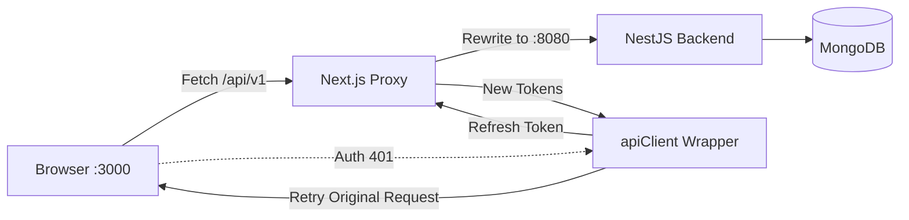

# Doctor Tracker -- Frontend Client

## 📖 Elevator Pitch

Doctor Tracker is a secure, high-performance administrative dashboard
built to manage doctors and their patients. Designed with a focus on
clean UX, data visualization, and optimized data-fetching strategies,
the application allows administrators to seamlessly create, edit, and
manage records.

By leveraging Next.js App Router, server-side proxying, and client-side
caching, the app delivers a smooth, responsive experience while securely
handling authentication flows (JWT + refresh tokens) and scalable REST
API pagination.

------------------------------------------------------------------------

## 🚀 Tech Stack

  -----------------------------------------------------------------------
  Layer                   Choice                  Role
  ----------------------- ----------------------- -----------------------
  **Framework**           Next.js 16 (App Router) Routing, Server/Client
                                                  Components, API
                                                  proxying

  **Language**            TypeScript              Strict typing and
                                                  scalable architecture

  **Styling**             Tailwind CSS v4         Utility-first CSS
                                                  framework

  **UI Components**       shadcn/ui               Accessible, reusable
                                                  components (dialogs,
                                                  tables, etc.)

  **Data Fetching**       TanStack Query (React   Server-state
                          Query) v5               management, caching,
                                                  background refetching

  **Charts**              Recharts                Declarative data
                                                  visualization (bar,
                                                  pie, and area charts)

  **Icons**               HugeIcons / Lucide      SVG icon library

  **Tooling**             Yarn, ESLint, Prettier, Package management,
                          Husky                   linting, formatting,
                                                  and Git hooks
  -----------------------------------------------------------------------

------------------------------------------------------------------------

## 🏗️ System Architecture

The frontend is a standalone Next.js application that communicates with
a NestJS backend and MongoDB database.

### Data Flow & Interactions

1.  **API Proxying:** The browser does not communicate directly with the
    backend port (`:8080`). Instead, requests are sent to `/api/v1/*` on
    the Next.js server (`:3000`), which proxies them to the backend
    using `next.config.ts` rewrites. This helps avoid browser CORS
    issues and keeps API requests on the frontend origin.
2.  **Authentication Flow:**
    -   On login, the backend returns an `accessToken` (short-lived) and
        a `refreshToken` (long-lived).
    -   The frontend stores the access token in memory (and
        `sessionStorage` for page reloads) and stores the refresh token
        in a cookie.
    -   A custom `apiClient` wrapper intercepts `401 Unauthorized`
        responses, queues concurrent requests, calls `/auth/refresh`,
        and retries failed requests.
3.  **State Management:** TanStack Query manages server state. Queries
    are cached and invalidated as needed. For example, creating a
    patient invalidates `["patients"]`, `["doctors"]` (to refresh
    patient counts), and `["dashboard"]` (to refresh analytics).
4.  **Route Protection:** A `proxy.ts` file protects dashboard
    navigation. Users without a session cookie are redirected to
    `/login`.

### Architecture Diagram



------------------------------------------------------------------------

## 🛠️ Setup Guide

### Prerequisites

-   Node.js (v18 or higher)
-   Yarn (`npm install -g yarn`)
-   Doctor Tracker backend running at `http://localhost:8080`

### Local Installation

1.  **Clone the repository:**

    ``` bash
    git clone <your-repo-url>
    cd doctor-tracker-client
    ```

2.  **Install dependencies:**

    ``` bash
    yarn install
    ```

3.  **Configure environment variables:**

    Create a `.env.local` file in the project root. You can copy
    `.env.example`:

    ``` bash
    cp .env.example .env.local
    ```

    Set the following value:

    ``` env
    NEXT_PUBLIC_API_BASE_URL=/api/v1
    ```

    > **Note:** Use `/api/v1` rather than the absolute backend URL so
    > requests are routed through the Next.js proxy.

4.  **Run the development server:**

    ``` bash
    yarn dev
    ```

5.  **Open the application:**

    Visit <http://localhost:3000> in your browser. Use the seeded
    credentials provided by your backend environment (for example,
    `admin@example.com / Admin@12345`, if configured).

------------------------------------------------------------------------

## 🧠 Technical Decisions

### 1. Why Proxy Rewrites Instead of Direct API Calls?

**Decision:** Configure `next.config.ts` to proxy `/api/v1` traffic to
the backend at `http://localhost:8080`, rather than having the browser
call port `8080` directly.

**Reasoning:** Requests routed through the Next.js origin can simplify
cross-origin request handling and reduce CORS complications. Cookie
behavior still depends on the cookie's attributes (`SameSite`, `Secure`,
`HttpOnly`, and `Domain`) and the proxy/backend configuration, so those
settings must be configured appropriately.

**Trade-off:** Adds an internal server hop and a small amount of
latency, but centralizes API routing and simplifies the browser-facing
architecture.

### 2. Why TanStack Query Instead of Standard `useEffect`?

**Decision:** Use `@tanstack/react-query` for data fetching, mutations,
and caching.

**Reasoning:** The application requires pagination, searching, and
filtering. Managing these concerns manually with `useEffect` and
`useState` can introduce race conditions, duplicate API calls, and
inconsistent loading states. TanStack Query provides request
deduplication, background refetching, pagination support (including
`placeholderData: keepPreviousData`), and query invalidation.

For example, creating a patient can invalidate patient, doctor, and
dashboard queries so related counts and charts refresh without a full
page reload.

**Trade-off:** Adds some bundle weight, but provides substantial
improvements in maintainability and user experience.

------------------------------------------------------------------------

## ✨ Core Features Implemented

### Authentication & Security

-   **Dual-token authentication:** Handles access and refresh tokens.
-   **Silent refresh:** Refreshes expired access tokens in the
    background and retries failed requests.
-   **Protected routes:** `proxy.ts` prevents unauthenticated access to
    `/dashboard`.
-   **Role-based UI:** The UI conditionally displays admin-only actions
    (create, edit, and delete), while the backend remains responsible
    for enforcing authorization.

### Doctor Management

-   **List & Search:** View doctors with case-insensitive search.
-   **Pagination:** Navigate large datasets efficiently.
-   **CRUD:** Admins can create, update, and delete doctor records.
-   **Patient Routing:** Navigate to a dedicated patient list for a
    selected doctor.
-   **Add Patient:** Add a patient directly from a doctor's page.

### Patient Management

-   **Global Patient List:** View patients across all doctors.
-   **Filtering:** Filter by condition and search by patient name.
-   **CRUD:** Edit and delete patient records.
-   **Contextual Creation:** Create a patient globally by selecting a
    doctor, or directly from a doctor's page.

### Dashboard Analytics

-   **Stat Cards:** Total doctors, total patients, average patients per
    doctor, and 30-day new-patient growth.
-   **Patients per Doctor:** Bar chart showing the doctors with the most
    patients.
-   **Condition Distribution:** Donut/pie chart showing common patient
    conditions.
-   **Registration Timeline:** Area chart showing patient registrations
    over the last 30 days.
-   **Doctor Specializations:** Bar chart showing doctors by
    specialization.

------------------------------------------------------------------------

## 📂 Project Structure

``` text
src/
├── app/
│   ├── (auth)/
│   │   └── login/            # Public login page
│   ├── dashboard/            # Protected application routes
│   │   ├── doctors/          # Doctor list and dynamic [id] patient list
│   │   ├── patients/         # Global patient list
│   │   ├── layout.tsx        # Sidebar and topbar layout
│   │   └── page.tsx          # Dashboard analytics and charts
│   ├── layout.tsx            # Root layout and providers
│   └── page.tsx              # Root redirect (/ -> /dashboard)
├── components/
│   ├── layout/               # Sidebar and topbar
│   └── ui/                   # Reusable UI components
├── features/
│   ├── auth/                 # AuthProvider, useAuth, login form
│   ├── dashboard/            # Dashboard queries
│   ├── doctors/              # Doctor queries and forms
│   └── patients/             # Patient queries and forms
├── lib/
│   ├── api-client.ts         # Fetch wrapper with 401 refresh queue
│   ├── types.ts              # Global TypeScript interfaces
│   └── utils.ts              # Shared utilities
└── proxy.ts                  # Route protection
```

------------------------------------------------------------------------

## 📸 Visual Evidence (Screenshots)

After completing the project, capture screenshots and save them in
`public/screenshots/`. Update the paths below if your filenames or
locations differ.

  View                  Screenshot
  --------------------- ------------------------------------
  Dashboard (Desktop)   `public/screenshots/dashboard.png`
  Doctors List          `public/screenshots/doctors.png`
  Patients List         `public/screenshots/patients.png`
  Mobile View           `public/screenshots/mobile.png`

------------------------------------------------------------------------

## 📜 Available Scripts

  -----------------------------------------------------------------------
  Command                             Description
  ----------------------------------- -----------------------------------
  `yarn dev`                          Runs the development server with
                                      Turbopack.

  `yarn build`                        Builds the application for
                                      production.

  `yarn start`                        Runs the production build.

  `yarn lint`                         Runs ESLint.

  `yarn typecheck`                    Runs the TypeScript compiler check
                                      (`tsc --noEmit`).

  `yarn format`                       Formats code using Prettier.
  -----------------------------------------------------------------------

------------------------------------------------------------------------

## 🔒 Environment Variables Example (`.env.example`)

``` env
# The API base URL. Requests are routed through the Next.js rewrite proxy.
# This helps avoid browser-side CORS issues.
NEXT_PUBLIC_API_BASE_URL=/api/v1
```

------------------------------------------------------------------------

## 📄 License

Add your project's license information here.
