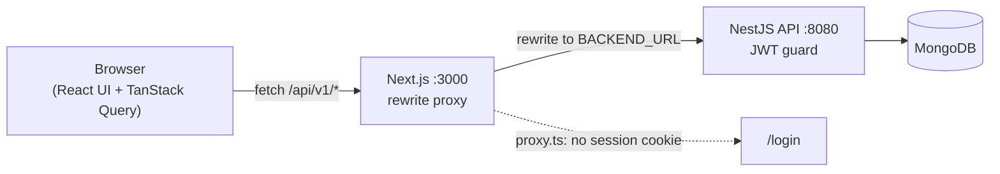
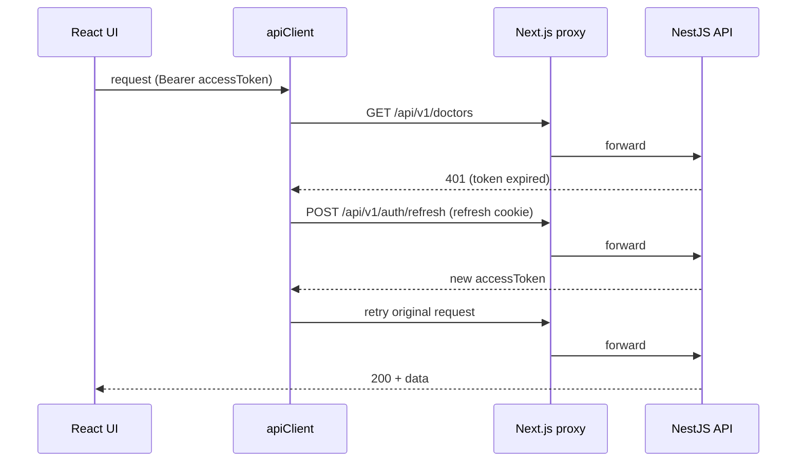

# Doctor Tracker — Frontend Client

## 📖 Elevator Pitch

Doctor Tracker is a secure administrative dashboard for managing doctors and their patients. Built with the Next.js App Router, it gives administrators a fast, responsive interface to create, edit and organise records, explore analytics (patient intake trends, condition distribution, doctor workload) and stay signed in safely through a JWT + refresh-token flow. A server-side proxy keeps all API traffic on a single origin, and TanStack Query keeps every list, count and chart in sync without full page reloads.

Live FE url : https://doctor-tracker-client.onrender.com/l

---

## 🚀 Tech Stack

| Layer | Choice | Role |
| --- | --- | --- |
| **Framework** | Next.js 16 (App Router) | Routing, Server/Client Components, API proxying |
| **Language** | TypeScript | Strict typing and scalable architecture |
| **Styling** | Tailwind CSS v4 | Utility-first CSS, responsive layouts |
| **UI Components** | shadcn/ui + custom components | Accessible primitives, plus custom `Modal` and `ConfirmDialog` |
| **Data Fetching** | TanStack Query (React Query) v5 | Server-state management, caching, background refetching |
| **Charts** | Recharts | Bar, donut, area and composed charts |
| **Icons** | HugeIcons / Lucide / inline SVG | Icon set |
| **Tooling** | Yarn, ESLint, Prettier, Husky | Package management, linting, formatting, Git hooks |

---

## 🏗️ System Architecture

The frontend is a standalone Next.js application. It talks to a NestJS REST API (port `8080`), which stores data in MongoDB.

### Data flow

1. **API proxying.** The browser never calls the backend directly. Requests go to `/api/v1/*` on the Next.js server (`:3000`), and `next.config.ts` rewrites them to `BACKEND_URL` (default `http://localhost:8080`). All API traffic stays on the frontend origin, which avoids CORS issues.
2. **Authentication.**
   - On login the backend returns a short-lived `accessToken` and a long-lived `refreshToken`.
   - The access token is kept in memory (and in `sessionStorage` so it survives a reload). The refresh token is stored in a cookie.
   - A custom `apiClient` wrapper attaches the `Authorization: Bearer` header, intercepts `401` responses, queues concurrent requests, calls `/auth/refresh` once, then retries everything that failed.
3. **State management.** TanStack Query owns server state. Mutations invalidate related queries. For example, creating a patient invalidates `["patients"]`, `["doctors"]` (patient counts) and `["dashboard"]` (analytics).
4. **Route protection.** `proxy.ts` redirects users without a session cookie from `/dashboard/*` to `/login`. The backend remains the source of truth for authorisation.

### Architecture diagram



### Silent token refresh



---

## 🛠️ Setup Guide

### Prerequisites

- Node.js **v20.9 or higher** (required by Next.js 16)
- Yarn (`npm install -g yarn`)
- The Doctor Tracker backend running locally at `http://localhost:8080` (see the `doctor-tracker-api` repository for its own setup)

### Local installation

1. **Clone the repository**

   ```bash
   git clone <your-repo-url>
   cd doctor-tracker-client
   ```

2. **Install dependencies**

   ```bash
   yarn install
   ```

3. **Configure environment variables**

   Copy the committed example file and adjust it if your backend runs elsewhere:

   ```bash
   cp .env.example .env.local
   ```

   | Variable | Required | Description |
   | --- | --- | --- |
   | `NEXT_PUBLIC_API_BASE_URL` | Yes | Base path the browser calls. Keep it as `/api/v1` so requests go through the Next.js proxy. |
   | `BACKEND_URL` | Yes in production, optional locally | Absolute URL of the NestJS API that `/api/v1/*` is proxied to. Defaults to `http://localhost:8080`. |

   > **Note:** `BACKEND_URL` is read in `next.config.ts` when the app is built, so it must be set **before** `yarn build` in deployed environments.

4. **Start the development server**

   ```bash
   yarn dev
   ```

5. **Open the app**

   Visit <http://localhost:3000> and sign in with an account from your backend's seed data (for example `admin@example.com` / `Admin@12345`, if your seed creates it). These are demo credentials only; never reuse them in production.

### `.env.example`

This file is committed to the repository root:

```env
# Base path the browser uses for API calls.
# Keep it relative so requests go through the Next.js rewrite proxy (no CORS).
NEXT_PUBLIC_API_BASE_URL=/api/v1

# Where Next.js proxies /api/v1/* to. Read at BUILD time in next.config.ts.
# Local development: the NestJS API on port 8080.
# Production (e.g. Render): your deployed API URL, without a trailing slash.
BACKEND_URL=http://localhost:8080
```

### Deployment notes (Render)

1. Deploy the NestJS API first and copy its public URL.
2. On the frontend service, set `BACKEND_URL` to that URL and `NEXT_PUBLIC_API_BASE_URL=/api/v1` **before the build starts**.
3. Redeploy the frontend whenever `BACKEND_URL` changes, because the rewrite target is baked in at build time.

---

## 🧠 Technical Decisions

### 1. Proxy rewrites instead of direct browser-to-API calls

**Context.** The frontend (`:3000`) and the API (`:8080`) are different origins, and the API issues JWTs plus a refresh-token cookie.

**Options considered**

| Option | Verdict |
| --- | --- |
| Browser calls the API directly with CORS enabled on NestJS | Needs an exact allowed-origin list per environment, `credentials: true`, and `SameSite=None; Secure` cookies across origins. Easy to misconfigure. |
| Custom Next.js route handlers as a backend-for-frontend | Maximum control, but every endpoint has to be re-implemented or forwarded by hand. |
| **`rewrites()` in `next.config.ts` (chosen)** | One config block forwards every `/api/v1/*` request to the backend. |

**Decision.** Proxy `/api/v1/*` to `BACKEND_URL` using Next.js rewrites. The browser only ever sees the frontend origin.

**Why it works for this project.** There is no cross-origin traffic to configure, so no CORS preflights. The API base URL is the relative path `/api/v1` everywhere in the code, so swapping environments is a single environment variable.

**Trade-offs**

- Each request makes an extra internal hop through the Next.js server (a small amount of latency).
- The rewrite destination is resolved at **build** time, so changing `BACKEND_URL` means rebuilding the frontend.
- Cookie behaviour still depends on the cookie's `SameSite`, `Secure`, `HttpOnly` and `Domain` attributes, so these must still be configured correctly.

### 2. TanStack Query instead of `useEffect` + `useState`

**Context.** Almost every screen is server state: paginated and searchable lists, dependent counts, and analytics charts that must stay consistent with each other.

**Options considered**

| Option | Verdict |
| --- | --- |
| `useEffect` + `useState` per component | Prone to race conditions (a slow older request overwriting a newer one), duplicate calls and inconsistent loading and error states. |
| Redux Toolkit / RTK Query | Capable, but adds store, slice and middleware boilerplate for state that is almost entirely server-owned. |
| **TanStack Query v5 (chosen)** | Built specifically for server state: caching, deduplication, background refetching and invalidation. |

**Decision.** Use `@tanstack/react-query` for all reads and writes.

**How it is used**

- **Pagination and search** use query keys that include the page and search term, so each combination is cached separately, and `placeholderData: keepPreviousData` keeps the old page visible while the next one loads.
- **Cross-screen consistency** comes from invalidation. Creating a patient invalidates `["patients"]`, `["doctors"]` (patient counts) and `["dashboard"]` (stat cards and charts), so every screen refreshes without a manual reload.
- **Mutation state** (`isPending`, `error`) drives button spinners, inline error messages and the "working" state of the delete confirmation dialog.

**Trade-offs.** It adds bundle weight and a learning curve around query keys and invalidation. In return it removes a large amount of hand-written loading and caching code.

---

## ✨ Core Features

### Authentication & security

- **Dual-token authentication** with a short-lived access token and a refresh token.
- **Silent refresh.** Expired tokens are refreshed in the background and failed requests are retried.
- **Protected routes.** `proxy.ts` blocks unauthenticated access to `/dashboard`.
- **Role-based UI.** Admin-only actions (create, edit, delete) are shown conditionally. The backend still enforces authorisation.

### Doctor management

- Case-insensitive search, pagination and a responsive table (cards on mobile).
- Create, edit and delete doctors in a modal form (specialization is a dropdown).
- Open a dedicated patient list for any doctor and add patients from there.
- Delete uses a confirmation dialog that shows progress and any server error.

### Patient management

- Global patient list with search and pagination.
- Create a patient globally (choose a doctor) or from a doctor's page.
- Edit and delete patients, with inline form validation.

### Dashboard analytics

- **Stat cards** with animated numbers, mini trend lines and growth badges: total doctors, total patients, average patients per doctor and 30-day new patients.
- **Smart insights** generated from the data: intake trend, top condition, workload alerts, busiest day and thin specialization coverage.
- **Range switcher** (7 / 30 / 90 days) and a manual refresh button.
- **Patients per doctor** bar chart, coloured by workload compared with the average.
- **Condition distribution** donut with interactive focus.
- **Registration timeline** area chart with a 7-day moving average.
- **Doctors per specialization** bar chart.

### Responsive design

- Desktop table layouts become card layouts on phones.
- Modals become bottom sheets on small screens.

---

## 📂 Project Structure

```text
src/
├── app/
│   ├── (auth)/
│   │   └── login/            # Public login page
│   ├── dashboard/            # Protected application routes
│   │   ├── doctors/          # Doctor list and dynamic [id] patient list
│   │   ├── patients/         # Global patient list
│   │   ├── layout.tsx        # Sidebar and topbar layout
│   │   └── page.tsx          # Dashboard analytics and charts
│   ├── layout.tsx            # Root layout and providers
│   └── page.tsx              # Root redirect (/ -> /dashboard)
├── components/
│   ├── layout/               # Sidebar and topbar
│   └── ui/                   # Modal, ConfirmDialog and shared UI
├── features/
│   ├── auth/                 # AuthProvider, useAuth, login form
│   ├── dashboard/            # Dashboard queries
│   ├── doctors/              # Doctor queries and forms
│   └── patients/             # Patient queries and forms
├── lib/
│   ├── api-client.ts         # Fetch wrapper with 401 refresh queue
│   ├── types.ts              # Global TypeScript interfaces
│   └── utils.ts              # Shared utilities
└── proxy.ts                  # Route protection
```

---

## 📸 Visual Evidence

Screenshots live in `public/screenshots/`. Each screen is shown at desktop width (1440 px) and phone width (390 px).

### Login

| Desktop | Mobile |
| --- | --- |
|  |  |

### Dashboard

| Desktop | Mobile |
| --- | --- |
|  |  |

### Doctors

| Desktop | Mobile |
| --- | --- |
|  |  |

### Patients

| Desktop | Mobile |
| --- | --- |
|  |  |

### Add Doctor modal

| Desktop | Mobile |
| --- | --- |
|  |  |

---

## 📜 Available Scripts

| Command | Description |
| --- | --- |
| `yarn dev` | Runs the development server with Turbopack. |
| `yarn build` | Builds the application for production. |
| `yarn start` | Runs the production build. |
| `yarn lint` | Runs ESLint. |
| `yarn typecheck` | Runs the TypeScript compiler check (`tsc --noEmit`). |
| `yarn format` | Formats code using Prettier. |

---

## 📄 License

Add your project's license information here.
